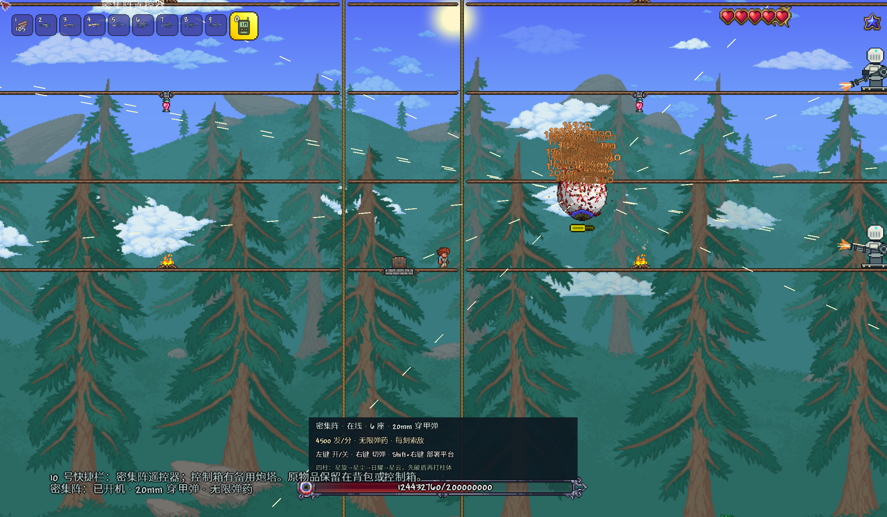

# Terraria: MW

Terraria: MW 是一个现代枪械与密集阵模组，当前版本 **1.3.1**，适用于 Terraria 1.4.4.9 / tModLoader 2026.8.3。内部模组名为 `ModernArsenal`，保留已有物品和世界的存档标识。

包含 24 把枪、逐枪开火动画、改枪界面、换弹与弹道、免费补给、4500 发/分密集阵、自动平台阵地和遥控器。Boss Rush API 与 Example Boss Rush 是可选的第三方连战前置，需另行安装。

**继续开发：[环境、构建、测试与代码入口](docs/DEVELOPMENT.md)**。克隆时使用 `git clone https://github.com/L0stInFades/Terraria-MW.git ModernArsenal`，设置 `TML_PATH` 后运行 `tools/build.ps1`。

双击 **启动现代军械库.bat**，直接进入独立的「现代军械·射击场」世界，角色为「新兵」。首次运行会在本地 `Play/` 创建正常生存试玩世界和示范住宅，角色持满弹匣 USP、600 发 .45 ACP、铜镐、铜斧和木材。存档和构建缓存不上传到仓库，测试使用隔离目录。

已有的现代工程启动器也能使用本模组。进入旧角色时会一次性补发 USP 和 600 发弹药；原有背包和世界由游戏按正常规则保存。

- [完整枪械与弹药图鉴](docs/军械图鉴.html)：24 把枪的外观、伤害、弹匣、射速、进度和全部弹药参数。
- [原创像素外观总览](docs/arsenal-contact.png)。
- [24 把枪的独立持握与开火动作](docs/ANIMATIONS.md)、[计入换弹的原版数值对照](docs/BALANCE.md)、[真实改件参考与玩法](docs/ATTACHMENTS.md)。
- [图片参考与轮廓研究](docs/REFERENCES.md)：24 项出处、观察记录和原创成品。参考照片与派生研究图保留在本地。
- [客户端实景：补给箱](docs/screenshots/armory.png)、[领弹](docs/screenshots/armory.png)、[USP 射击](docs/screenshots/usp.png)。
- [正常游玩入口的家中补给箱与开局装备](docs/screenshots/home-crate.png)。
- 成品包：`artifacts/ModernArsenal.tmod`。

## 密集阵与平台阵地

1.3 版加入 4500 发/分的密集阵炮塔与无限弹药遥控器。10 号快捷栏遥控器：左键开关、右键切弹、Shift+右键部署标准平台；`/arsenal ciws` 补给并返回附近阵地。初次试玩预建 6 层平台和 6 座炮塔，控制箱有备用炮塔。四柱先破盾，按星旋→星尘→日耀→星云处理；其他 Boss 按可伤害部位与弱点索敌。[完整操作、平台设计与资料](docs/CIWS.md)。

## 补给与操作

右键家中的绿色补给箱，点击卡片领取。枪械和弹药均免费，领取一次弹药得到 600 发；背包满时不会覆盖物品。所有弹药都没有合成配方，出售价值为零。已携带的同款枪不能反复领取。

补给箱优先寻找出生点附近的安全室内空地，再寻找玩家床位、NPC 住宅和远处床铺。需要连续三格实心平地和两格净空，避开房门、液体与出生列；不会清除家具、地形或箱子。新世界没有家时先放在出生点附近，之后每 10 秒检测房屋并迁入。可用镐挖走并重新摆放；没有安全位置时等待玩家建出空间。

持枪按 **R** 换弹，空弹匣开火也会触发换弹。切换武器或死亡会取消装填，未完成的装填不会扣储备。弹药栏优先于背包；未打空的弹匣补入相同弹种。要改用 AP / JHP 等弹种，打空弹匣，再把目标弹药放到更靠前的弹药栏。所有枪支持持续按住开火，M16A4、FAMAS 按三连发节奏工作。

选中枪械后，站立、行走、空仓和换弹时都持续显示。24 把枪分别配置了套筒、枪机、泵动、拉栓或弹链动作，以及后坐、枪口焰和抛壳。按 R 可打断正在进行的连发，剩余弹丸不会在换弹中继续射出；切枪取消旧枪的动作与装填，不会暗扣弹药。

按 **V** 打开当前这把枪的改枪界面，免费切换消音器、白光手电和可见激光 / 红外瞄准模块。红外瞄准需要夜视装备，界面可领取原版夜视头盔。设置保存在每把枪上；开界面时不能开火，切枪自动关闭。开始改装前需停止开火并完成换弹。

弹匣容量、剩余发数及已装弹种随物品保存，移动物品和退出世界不会丢失；不需要每次登录重新装填。狙击与精确射手枪械开启原生瞄准缩放，移动会放大散布。

单人试玩可在聊天栏输入 `/arsenal god on` 开启并保存无敌，`/arsenal god off` 关闭；`/arsenal all` 配齐全部 24 把枪、装满弹匣，并把 19 种弹药各补到至少 600 发。枪械排列在背包前 24 格，原有工具和材料保留在后面；空位不足时会提示腾出空间。

Boss 连战试玩使用 **Example Boss Rush + Boss Rush API**。`/arsenal rush` 直接开始连战，再次输入可停止，背包装满也能使用；命令调用该模组月亮橡实的原生启停逻辑。模组未启用时给出提示。[安装来源、兼容检查与操作](docs/BOSS_RUSH.md)。

## 伤害与进度

1.2 版将全部 24 把枪的基础伤害整体提高。USP 本体 **1025**，FMJ **+9**；Vector 本体 **8800**；Intervention **151025**；Barrett **167950**。射手装备、前缀、暴击与弹药继续影响实际输出，现有背包里的枪在重载后直接使用新数值。

百万满血、84 防御、600 像素距离、每两发故意打偏一发的原生碰撞校准中，Vector 用 **21.93 秒**、Barrett 用 **3.73 秒**完成击杀；射击与实际发生的换弹均计时。模型是固定目标，完整条件、逐枪结果及论坛来源见 [1.2 调整记录](docs/REBALANCE_1.2.md)。

| 阶段 | 开放条件 | 代表枪械 |
| --- | --- | --- |
| 新兵 | 开局 | USP、M9、MP5 |
| 战术 | 克苏鲁之眼 | 沙鹰、UMP45、M4A1、AK-47、M16A4、M1014 |
| 精锐 | 邪恶首领或骷髅王 | P90、G36C、FAMAS、SPAS-12、RPD、M21 EBR |
| 特战 | 困难模式 | Vector、SCAR-H、ACR、M249、Intervention |
| 重装 | 任一机械首领 | AA-12、M60E4、MK14 |
| 王牌 | 世纪之花 | Barrett .50cal |

后期武器通过单发威力、散布、弹匣与换弹时间区分用途：ACR 准确稳定，Vector 近距离爆发强但弹匣小，轻机枪能持续压制但换弹慢，Intervention 高暴击，Barrett 提供高伤害半自动重火力。

1.2 版另行检查 30 秒原生发射与完整换弹的长期弹匣循环；普通 FMJ 下 Vector 约 **9 万 / 秒**、Barrett 约 **30 万 / 秒**。24 把枪仍按手枪、步枪、霰弹、机枪和狙击的射击节奏区分，逐枪数值见 [数值对照](docs/BALANCE.md)。

## 弹药和弹道

10 种口径：9×19mm、.45 ACP、.50 AE、5.7×28mm、5.56×45mm、7.62×39mm、7.62×51mm、.408 CheyTac、.50 BMG、12 Gauge。各枪只装兼容口径。

FMJ 为通用弹；AP 增加穿甲并最多穿透 2～5 个敌人，每穿过一个目标剩余伤害降低 15%；JHP 对低防御目标额外增伤；曳光弹有明亮轨迹；Match 弹具有低下坠和长射程；00 Buckshot 一发消耗一颗弹药，产生 8～9 个弹丸；Slug 把霰弹云转换为一枚集中重弹，保留约 78% 的全霰弹命中伤害。

弹丸每游戏刻执行 8 次移动与碰撞，按口径施加水平速度损失、重力、射程和远距伤害衰减，墙体会阻挡所有弹种。参数采用游戏单位，不代表真实枪械性能。具体射程、穿甲和下坠值见图鉴。弹匣制在完成装填时扣除储备；原版节弹词条不会返还已装入的弹药。

## 构建与验证

在本目录执行 `tools/build.ps1` 构建；`tools/test.ps1` 运行原生世界、物品、领弹、换弹、碰撞与伤害验证；`tools/test.ps1 -Reload` 用新进程校验存档；`tools/client-test.ps1` 在副本中运行真实客户端验收并截图；`tools/compat-test.ps1` 在既有工程世界副本中验证两模组兼容与入户补给箱；`tools/install.ps1` 安装到默认 tModLoader 和当前工程世界的模组目录。

`tools/presentation-test.ps1` 检查 24 把枪的持续持握、逐枪机械动作、改装、夜视、照明、近身命中及 R 中断三连发；平衡审计使用服务器参数 `-arsenalbalance <报告路径>`，然后执行 `python tools/generate_docs.py`，会断言每枪的两项持续输出均满足上述对照。

`Verification/` 中的检查与装备准备入口只在显式传入相应启动参数时运行，正常游玩不会自动运行。已保存的验证快照见 [docs/verification](docs/verification/README.md)。

本次不包含完整生存通关或真人多人联机验收；联网补给有服务端距离、进度和索引校验，弹匣有网络序列化验证。1.2 以后整体提高了基础伤害以适配当前强化连战；其他修改生命、护甲或无敌阶段的模组仍需实测调校。

1.3.1 的单人装备入口 `tools/play.ps1 -Flight` 会把原版天界星盘与飞升之证装入空闲饰品栏，并校验实际无限飞行效果及玩家文件重载；现有装备和背包不覆盖。按住空格升空，空格配合下键可悬停，空格配合上键加速上升。
