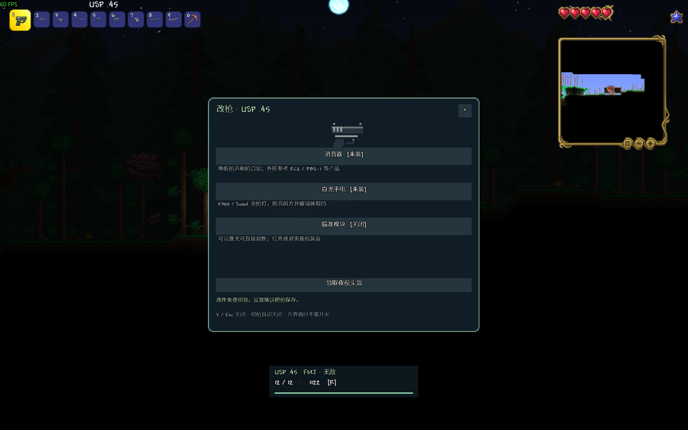

# 当前交付与验证范围

当前源码版本为 **1.3.1**：包含 24 把枪、持握与逐枪开火动画、改装、换弹和弹道、免费补给、Boss 连战接入、密集阵与平台阵地，以及单人飞行装备准备入口。

| 模块 | 已完成验证 |
| --- | --- |
| 枪械基础功能 | 76 项服务器回归，另有独立进程的玩家与世界重载检查 |
| 表现与改装 | 24 枪持握、机械帧、抛壳、V 改装、夜视与照明、R 中断连发及保存检查 |
| 1.2 强度 | 百万满血、84 防、600 像素和故意失误的原生碰撞校准；完整弹匣换弹成本另行采样 |
| 1.3 密集阵 | 53 项服务器检查、4 项真实重载、15 项客户端检查；六座炮塔各 750 发 / 600 刻，四柱由原生消盾魂和实际击杀按顺序完成 |
| 1.3.1 飞行装备 | 天界星盘与飞升之证的实际装备效果、无限飞行标志、玩家文件保存与重载 |

带版本号的原始报告快照见 [verification](verification/README.md)，操作与复查方法见 [开发说明](DEVELOPMENT.md)。报告反映其记录版本，不代表后续修改自动通过。

原始存档、个人备份、完整运行日志与游戏反编译保留在本机，不上传到仓库。真实多人联机与全部模组首领的完整生存通关尚未验收。
